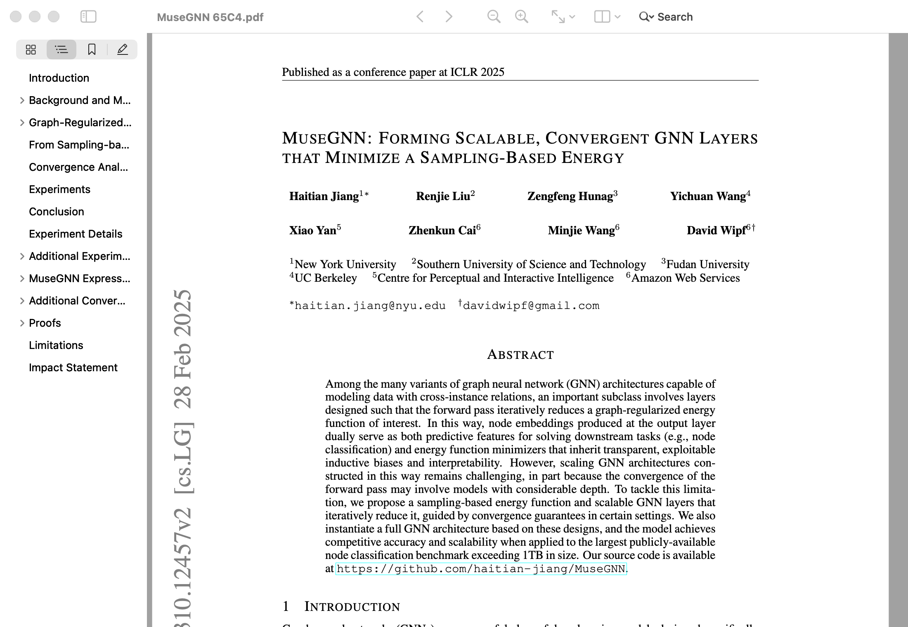
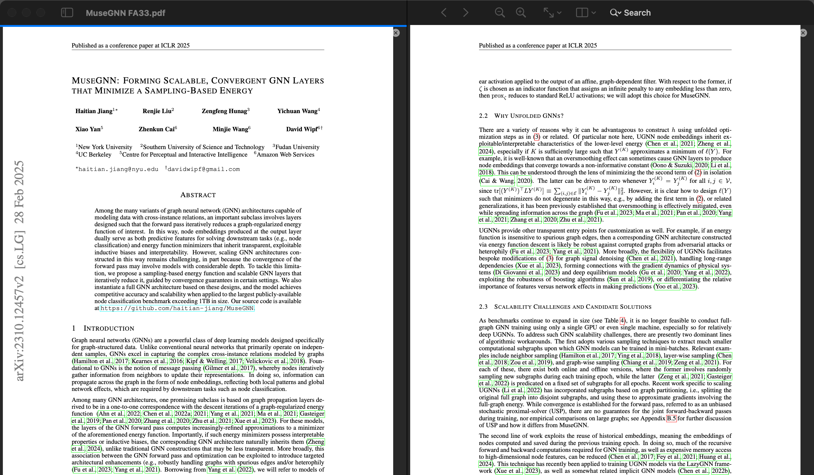

# Lectern

A free, open-source PDF reader for the Mac: fast, calm and built for reading. It's meant for people who spend hours in long books, academic papers, manuals and reports, and it aims to feel like a natural part of macOS rather than a document-processing suite.

**Never lose your place.** When you follow a reference, footnote, figure or cross-reference, Lectern lets you preview the destination, or open it beside the page you're on, without leaving where you were reading.

Lectern is a PDF reader first, plus a personal space for highlights and notes. It isn't a tool for creating, converting or managing documents.





*Rendered offscreen by the snapshot tests (`AppTests/M5/SnapshotTests.swift`), so the toolbar's glass is drawn flat. The paper is "MuseGNN" by Haitian Jiang et al., [arXiv:2310.12457](https://arxiv.org/abs/2310.12457), CC BY 4.0. In dark mode the pages keep their own colours.*

## Principles

- **No AI features.**
- **No telemetry.** No analytics, crash reporting or tracking of any kind.
- **No account,** no subscription, no ads and no paid unlocks.
- **Works offline.** Nothing needs the internet. The only network use is an update check, which is off unless you turn it on.
- **Your documents stay yours.** Reading never modifies a file. Annotations are standard PDF annotations, written only when you save, and appended without rewriting the file. Reading positions, bookmarks and history stay on your Mac.
- **Sandboxed.** The app runs in the macOS App Sandbox, so a malicious PDF has little to reach. It never runs a document's JavaScript and blocks links that would launch apps or open other files.

## Features

- **Reading:** single or two-up pages, continuous or paged scrolling, cover-page and right-to-left spreads, fit page and fit width, view-only rotation, full screen and distraction-free mode, native tabs and windows.
- **Link previews:** hover over a link, Force Click it or reach it from the keyboard (⌥⇥) to preview the destination in a popover, then Go, Open in Split or Dismiss. The split view shows two places in the same document side by side, each with its own history.
- **Navigation:** thumbnails, table of contents, Go to Page by the document's own page labels, and back/forward history that records jumps rather than scrolling.
- **Keeping your place:** your position survives zooming, resizing, layout changes, rotation, a file changing on disk, and relaunching. Lectern can reopen your last session.
- **Search:** results as they're found, with Match Case and Whole Word. Scanned pages are reported as having no searchable text instead of silently finding nothing.
- **Annotations:** highlight, underline, strike-through, sticky notes and comments in six colours, with undo, an annotation list, and a crash journal that offers back unsaved work. Signed and certified files are saved as a copy so their signatures stay intact.
- **Reader bookmarks:** named places in a document, kept on your Mac and exportable as JSON.
- **Passwords and permissions:** encrypted PDFs, the document's own restrictions respected, and an optional "Remember in Keychain". Annotations can be saved into password-protected PDFs, which stay encrypted with the same password.
- **Accessibility:** every control has a name and works from the keyboard, Help ▸ Keyboard Shortcuts lists every shortcut, and animations follow Reduce Motion.

What Lectern doesn't do yet is listed in [docs/known-limitations.md](docs/known-limitations.md). In short: forms are read-only, pages are never recoloured in dark mode, scanned PDFs aren't run through text recognition, and the app isn't signed with an Apple Developer ID.

## Lectern and Preview

Preview comes with every Mac and does a bit of everything: it fills in forms, signs, merges and reorders pages, and edits images. Lectern does less, and spends all of it on reading. Keep Preview for working on a document; use Lectern when you'll spend hours inside one.

| | Preview | Lectern |
|---|---|---|
| **Following a reference** | A click takes you there | Hover, Force Click or ⌥⇥ shows the destination first: Go, Open in Split, or Dismiss and keep reading |
| **Two places in one document** | One view per document | A split with two panes, each with its own place, zoom and history |
| **Saving highlights and notes** | Built on Apple's PDFKit, whose save rewrites the whole file and so breaks digital signatures | Appends to the end of the file and leaves what's already there untouched. Signed and certified files are saved as a copy so their signatures stay intact |
| **When the file changes** | Edits are saved automatically, rotating a page included | Only when you choose Save. Rotation is view-only, and a crash journal keeps unsaved work |
| **Forms, signing, editing pages** | Yes | No, by design: forms are shown read-only |
| **Text in scanned pages** | Live Text can select it | Not yet: Lectern says the page has no searchable text |
| **Source** | Closed, part of macOS | Open source (GPL-3.0) |

In Lectern's tests, PDFKit's whole-file rewrite dropped page labels, the revision history, custom metadata and parts of the form structure, even when nothing had been changed ([docs/spikes/m0b-pdfkit.md](docs/spikes/m0b-pdfkit.md#6-the-whole-file-rewrite)). That's why Lectern writes its own changes instead.

## Status

**Lectern 1.0.0 is out** (31 October 2026). Download it from the [latest release](https://github.com/ronimoe/pdf-reader/releases/latest), or install it with Homebrew ([docs/INSTALL.md](docs/INSTALL.md)). [CHANGELOG.md](CHANGELOG.md) lists what's in 1.0.0, and [docs/progress.md](docs/progress.md) logs how it was built.

It needs **macOS 26 (Tahoe) or later on Apple Silicon.**

## Install

The quickest way is one line in Terminal. It downloads the latest release, checks its SHA-256 and copies Lectern into Applications, with no Open Anyway step:

```sh
curl -fsSL https://raw.githubusercontent.com/ronimoe/pdf-reader/main/scripts/install.sh | zsh
```

See [docs/INSTALL.md](docs/INSTALL.md) for what that line does, and for:
- the Homebrew tap: `brew tap ronimoe/lectern && brew install --cask lectern`;
- the DMG, with the one-time **Open Anyway** step;
- building from source;
- updating and uninstalling.

The app isn't signed with an Apple Developer ID. A DMG downloaded in a browser has to be allowed once in System Settings; the Terminal line and Homebrew skip that step. INSTALL.md explains how and why.

## Getting started

- **Open a PDF** with **File ▸ Open…** (⌘O), by dragging it onto Lectern, or from **File ▸ Open Recent**. Lectern never makes itself the default PDF app. To make it yours, choose **Get Info** on a PDF in Finder, then **Open with ▸ Lectern ▸ Change All…**.
- **Find your way** with the sidebar (⌃⌘S): thumbnails, contents, bookmarks, annotations and search results. ⌘F searches, ⌥⌘G goes to a page, and ⌘[ and ⌘] go back and forward.
- **Preview a link** by resting the pointer on it, or by Force Clicking it. Use **Open in Split** to keep both places in view.
- **Annotate** by selecting text and choosing from the **Annotate** menu or the selection bar, then save with ⌘S.
- **Help ▸ Keyboard Shortcuts** (⌘/) lists every shortcut. **Lectern ▸ Settings…** (⌘,) has the reopen-on-launch, link-preview, annotation-author and update options.

## Building from source

Needs Xcode 27 and [XcodeGen](https://github.com/yonaskolb/XcodeGen) (`brew install xcodegen`). The Xcode project is generated from `project.yml` and isn't committed.

```sh
xcodegen generate
xcodebuild -project Lectern.xcodeproj -scheme Lectern -configuration Release -derivedDataPath build/DerivedData build
```

The app is at `build/DerivedData/Build/Products/Release/Lectern.app`; [INSTALL.md](docs/INSTALL.md#build-from-source) shows how to install it. You can also open `Lectern.xcodeproj` in Xcode. Library code lives in the local Swift package `Packages/LecternKit`.

**Release packaging.** `scripts/release/build-dmg` builds an ad-hoc signed Release app and packages it as a DMG in `build/release/`. `scripts/release/verify-dmg` checks that DMG, including a headless self-check of the app. INSTALL.md's developer notes cover the other release scripts.

## Testing

```sh
scripts/corpus/bootstrap   # once: Python and Node tools for the corpus checks, and the large test PDFs
scripts/test.sh            # package tests and app-hosted tests, headless
scripts/perf.sh            # performance on the representative documents (docs/performance.md)
```

`scripts/test.sh` regenerates the project, then runs the package tests (`swift test`) and the app-hosted tests (`xcodebuild test`). Logs go to `build/logs/`.
- The tests never show UI: a tripwire fails any test that tries to show an alert, sheet or panel.
- The save-engine tests check the test collection in `Tests/Corpus/` with external PDF tools, and `scripts/test.sh` fails if those tools are missing. The bootstrap script expects `qpdf`, `mupdf-tools` and `poppler` from Homebrew. See [Tests/Corpus/README.md](Tests/Corpus/README.md).

## Contributing

Contributions are welcome under the project's licence.

- **Read first:** [docs/product-spec.md](docs/product-spec.md) for what Lectern is for and what it deliberately won't do (§6), and [docs/decisions.md](docs/decisions.md) for the product decisions.
- **Changes that touch the design** should keep [docs/architecture.md](docs/architecture.md) true, with a dated "Amended" note where it changes.
- **Ground rules:**
  - no AI, telemetry, accounts or network use without opt-in;
  - never write a PDF with PDFKit's own save; annotations go through the incremental writer (`PDFSave`);
  - give `ReaderPDFView` its document through `show(_:)`, never by assigning `document`.
- **Tests:** `scripts/test.sh` must pass, twice in a row for anything touching windows or timing. Add a test that fails without your change.
- **Reports:** for a bug in a specific PDF, say where the file comes from and whether it can be shared. Only redistributable files can join `Tests/Corpus/public/`.

## Documentation

| Document | What it covers |
|---|---|
| [docs/INSTALL.md](docs/INSTALL.md) | Installing, updating, uninstalling and why the app isn't signed |
| [docs/known-limitations.md](docs/known-limitations.md) | What 1.0 doesn't do, and what hasn't been checked by hand |
| [CHANGELOG.md](CHANGELOG.md) | What's in each release |
| [docs/product-spec.md](docs/product-spec.md) | What Lectern is for: goals, users, features and acceptance criteria |
| [docs/decisions.md](docs/decisions.md) | The product decisions |
| [docs/architecture.md](docs/architecture.md) | How it's built: engine, structure, storage, build, release and milestones |
| [docs/performance.md](docs/performance.md) | Performance measurements and thresholds |
| [docs/acceptance.md](docs/acceptance.md) | The release acceptance criteria, one by one, with evidence |
| [docs/release-checklist.md](docs/release-checklist.md) | Publishing a release, and the checks still owed by hand |
| [docs/progress.md](docs/progress.md) | Build log, milestone by milestone |
| [docs/spec-review.md](docs/spec-review.md) | Open questions raised against the spec |
| [docs/spikes/](docs/spikes/) | Prototype reports: saving (M0a, M4a), PDFKit behaviour (M0b), platform and distribution (M0c) |

## License

[GPL-3.0](LICENSE), except the Lectern logo and app icon, which forks must replace with their own ([`design/logo/LICENSE.md`](design/logo/LICENSE.md)). Lectern includes [Sparkle](https://sparkle-project.org) (MIT) for its opt-in update checks; the app shows both licences under **Help ▸ Licence** and **Help ▸ Acknowledgements**.
